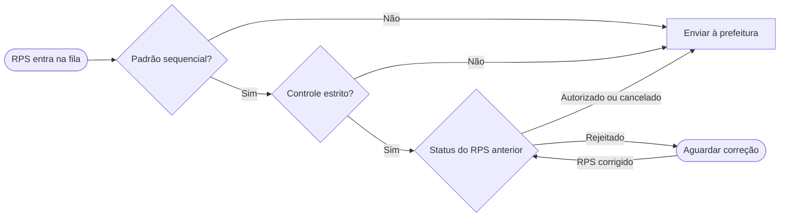

# Emissão sequencial de RPS

> Fonte: [Emissão Sequencial de RPS](https://desenvolvedores.migrate.info/ModulosFiscais/Documentos/NFSe/EmissaoSequencialRPS/) (31/03/2026) e páginas dos padrões citados.

## Resumo

Algumas prefeituras exigem RPS em **sequência**: se houver pulo de numeração ou um RPS for rejeitado, a prefeitura **não autoriza o próximo** até o problema ser resolvido. O InvoiCy controla isso automaticamente, mas o comportamento depende do **Tipo de processamento** da empresa (*Configurações para emissão → Ambientes*).

## Síncrono × assíncrono

| Tipo de processamento | Quem controla a ordem |
| :--- | :--- |
| **Síncrono** | O **ERP**. Cada RPS vai para a prefeitura assim que chega, sem fila. O ERP deve enviar na ordem certa e esperar o resultado antes do próximo. |
| **Assíncrono** | O **InvoiCy**. Os RPS entram numa fila, e o InvoiCy só envia quando as regras do município são atendidas. A configuração é feita pelos analistas do InvoiCy, sem ação do cliente. |

Para padrões sequenciais, **prefira o assíncrono** (recomendação explícita no CONAM).

## Comportamentos da fila assíncrona

| Regra do município | O que o InvoiCy faz | O que você faz |
| :--- | :--- | :--- |
| **Controle estrito de sequência** | Só envia o próximo RPS quando o anterior estiver **autorizado** ou **cancelado**. Um rejeitado segura a fila. | Corrija o RPS rejeitado e reenvie; a fila destrava. |
| **Reaproveitamento de número após cancelamento** | Se o último RPS for cancelado, a prefeitura exige o **mesmo número** no próximo. Por isso o InvoiCy **bloqueia o cancelamento da última nota**. | Não cancele a última nota: emita a próxima já correta e, se preciso, cancele a anterior depois. |
| **Cadenciamento por instabilidade** | Envia **um por vez** para evitar conflito em prefeituras instáveis. Rejeitados **não** bloqueiam a fila. | Nada. |

## Aviso de fila parada

O [Webhook de NFS-e](webhook-nfse.md) tem a notificação **Emissão Parada**: avisa quando um documento não entra na fila porque há pendência em RPS anteriores, para o ERP identificar e corrigir o RPS que travou a sequência.

## Mensagens do InvoiCy relacionadas

- **inv0346** - registro entrou na fila assíncrona (municípios sequenciais demoram mais).
- **inv0337** - documento em processamento na prefeitura.
- **inv0354** - documento saiu da fila (processado ou rejeitado 3 vezes seguidas).

Ver [invoicy-inv03xx.md](../../03-rejeicoes/invoicy-inv03xx.md).

## Padrões com sequência

| Padrão | Particularidade |
| :--- | :--- |
| CONAM | Sequência pelo último RPS efetivado; o InvoiCy bloqueia o cancelamento da última nota. |
| DSFNET | Rejeição bloqueia as seguintes; cancelamento **não** reaproveita o número (cancelou o 5, o próximo é o 6). |
| IPM | Alguns municípios (desde 2020). |
| WebISS | Alguns municípios. |
| Betha | Chapecó e Lagoa Vermelha: numeração sequencial crescente. |
| TINUS | Numeração sequencial independente da série. |
| Sigcorp TXT | Numeração sequencial. |
